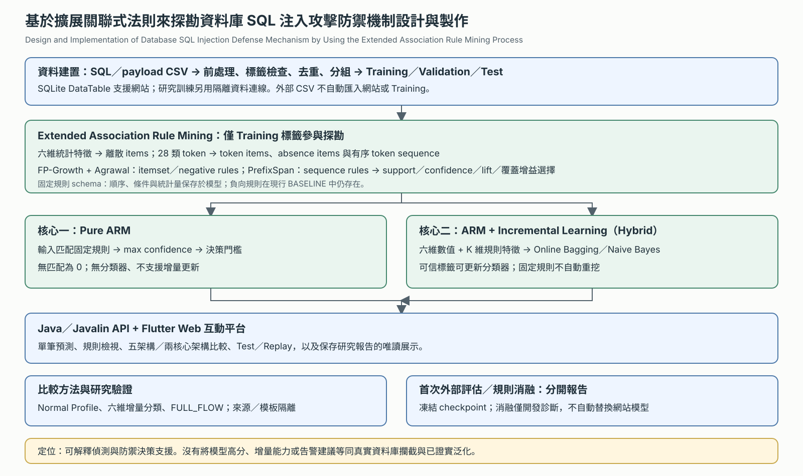
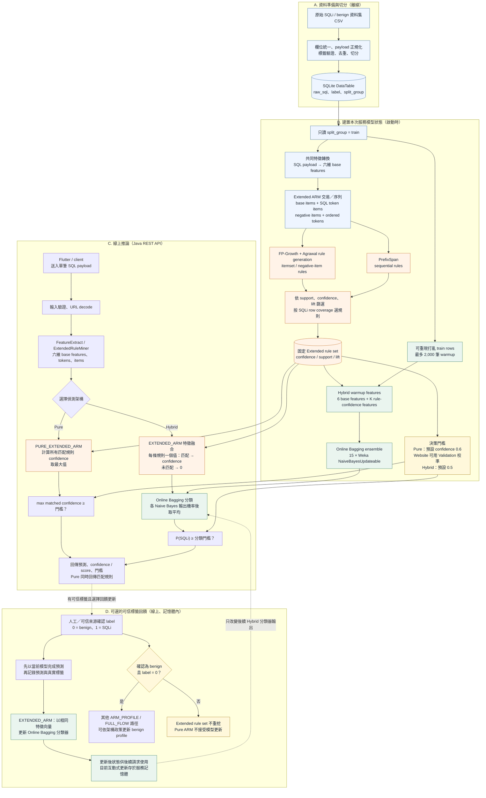
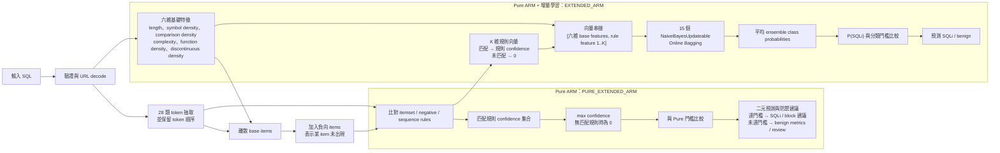
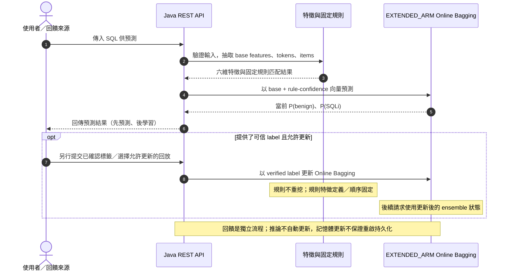
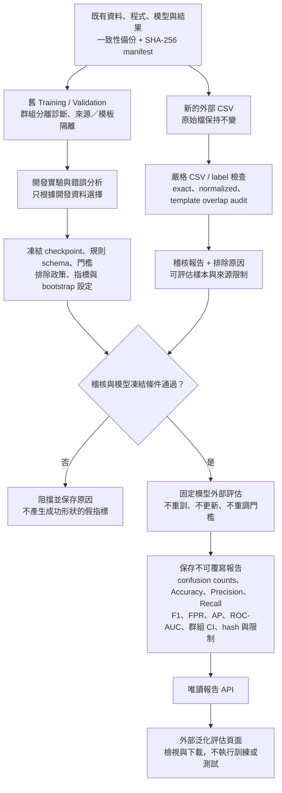
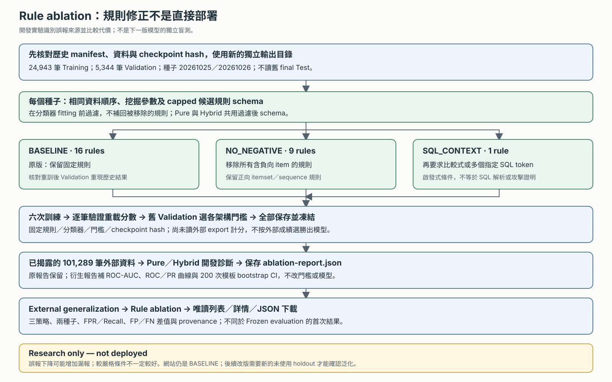

# Pure ARM 與 Pure ARM + Incremental Learning 架構

本文件依目前 `sqlia_backend` 的 `PURE_EXTENDED_ARM` 與 `EXTENDED_ARM` 實作整理。
本文所稱的「Pure ARM」是規則-only 的 **Pure Extended ARM**；「Pure ARM + Incremental Learning」
是以相同 Extended ARM 規則產生特徵，再交給增量分類器的 **Extended ARM 混合架構**。
兩者共用規則探勘來源，但預測方式、模型狀態與回饋更新能力不同。

### 專題圖組（對應目前程式）

專題題目：**基於擴展關聯式法則來探勘資料庫 SQL 注入攻擊防禦機制設計與製作**。
系統定位是 SQLi 偵測、解釋與防禦決策支援，並未實作資料庫代理或真實查詢攔截。

1. [專題整體架構](project_system_overview.svg)：擴展規則為核心，Java／Flutter 與研究邊界。
2. [單筆五架構推論與 Pure／Hybrid 對照](single_sql_prediction_flow.svg)：區分兩種規則決策方式。
3. [訓練與評估隔離](dataset_architecture_comparison_flow.svg)：網站、研究、Test、外部與更新路徑。
4. [規則消融與唯讀展示](rule_ablation_flow.svg)：兩種子、三策略、凍結與開發診斷。

圖組以目前 `ApiServer`、`ModelStateService`、`WebsiteComparisonService`、
`GeneralizationRunner`、`RuleAblationRunner` 與唯讀報告頁為準。前端既有五張單架構
assets 是另一組資源；本次修改的是 docs 圖組，不自動改寫網站 assets。

## 一、網站服務建模與兩核心架構總覽

下圖的 2,000 筆 warmup 與預設門檻是網站啟動路徑，不代表凍結研究 checkpoint。
研究訓練／外部評估另見第三張 SVG；規則消融候選不會回寫此網站路徑。

## 二、兩種架構的推論資料路徑

## 三、增量回饋與評估時序

## 四、逐層詳細說明

### 1. 資料來源與切分

1. 原始 CSV 經過欄位統一、payload 正規化、標籤驗證、去重與資料切分，寫入 SQLite
   `DataTable`。每筆資料至少需要原始 SQL payload、二元標籤及 split group。
2. Extended ARM 規則只從 `split_group='train'` 取得。驗證集與測試集不參與規則探勘，
   避免把評估資料中的標籤關係直接編入規則。
3. 規則交易中的 class item 只在訓練探勘時加入，用來產生
   `antecedent => SQLi` 規則；它不是線上輸入特徵，推論時不會帶有真實標籤。
4. 網站 Hybrid 分類器 warmup 使用可重現打亂順序的 train rows，最多 2,000 筆。
   規則與分類器都在服務初始化時準備好，後續請求使用該服務狀態。
   研究 runner 是另一流程：本次基準與規則消融使用全部 24,943 筆 Training，
   不能把它的成績當作網站 warmup 模型成績。

### 2. 共用輸入表示：base features 與 ARM items

`FeatureExtract` 將 URL-decoded SQL payload 轉成六個數值特徵：

| 特徵 | 意義 |
|---|---|
| `payloadLength` | payload 字元長度 |
| `symbolDensity` | 非英數、非空白符號數除以長度 |
| `comparisonDensity` | 比較運算子數除以長度 |
| `complexity` | 是否含字母、數字、符號三類的計數（0 至 3） |
| `functionDensity` | 白名單 SQL function 呼叫數除以長度 |
| `discontinuousDensity` | 空白／控制字元與註解計數除以長度 |

ARM 不直接使用連續數值，而是把數值離散成 base item，例如長度是否大於 100、
symbol density 是否大於 0.30，以及 comparison、complexity、function 類別。
Extended Rule Miner 再從 SQL 抽取最多 28 類 token（例如 quote、`UNION`、`SELECT`、
註解標記與比較式形狀），建構三類匹配條件：

- **Itemset rules**：不要求特定順序的 item 組合。
- **Negative-item rules**：除「出現某 item」外，也能表達「未出現某 item」。
- **Sequential rules**：要求 token 以指定先後順序出現。

Tokenizer 保留最多 40 個 token 位置，並折疊連續相同 token；28 是 token 類型數，
不是每筆輸入長度。原 token 名稱雖稱 tautology，實作辨識的是比較式形狀，
例如 `1=2` 也會命中，不代表已判定恆真或驗證 SQL 可執行。

因此，線上比對必須依照相同 decode、feature、token 與 item 建構流程執行；規則本身
不是直接對原始 SQL 字串做任意文字搜尋。

### 3. Extended ARM 規則建置

目前預設的 Extended ARM 設定為：`minSupport=0.1`、`minConfidence=0.6`、
`minLift=1.5`、最大規則長度 3，並對 itemset 與 sequence 規則家族分別限制規則數。
itemset 規則由 FP-Growth / Agrawal rule generation 建立；序列規則由 PrefixSpan 建立。
候選規則先按 lift、support 排序，再用 SQLi 訓練列覆蓋增益貪婪挑選，以減少重複規則。

規則集合在本次模型 session 內保持固定。每條規則含 antecedent、support、confidence、
lift 及是否為序列規則；線上預測回傳的 matched rules 可供解釋與檢視。

### 4. Pure ARM：`PURE_EXTENDED_ARM`

1. 對輸入 payload 建立 base items、token items、negative items 與 token sequence。
2. 逐條檢查固定規則是否匹配；只保留匹配規則的 confidence，取其中最大值作為
   SQLi confidence。沒有任何規則匹配時，分數為 0。
3. 將最大 confidence 與 Pure ARM 決策門檻比較。網站服務可以在 Validation split
   校準此門檻（以最大 F1 為目標，同分時選較低 FPR）；實驗預設值為 0.6。
4. 此路徑沒有 ML classifier，也沒有 online update。帶入 `PURE_EXTENDED_ARM` 的更新請求
   不會訓練規則或改寫模型，而是明確不支援。
5. 對二元評估而言，低於門檻會計為 benign；對防禦建議而言則應視為 `review`，不是
   `allow`。沒有命中目前規則，不能證明 SQL 安全。

### 5. Pure ARM + Incremental Learning：`EXTENDED_ARM`

1. 使用同一套固定規則匹配，但不把「最大規則 confidence」直接當最終分類結果。
2. 建立 Hybrid 輸入向量：前六欄為數值 base features，後續每條規則各佔一欄。
   規則匹配時該欄為該規則 confidence；未匹配時為 0。若本 session 有 K 條規則，
   向量維度是 `6 + K`。
3. warmup 階段使用帶標籤 train rows 更新 Online Bagging；ensemble 有 15 個
   `NaiveBayesUpdateable` base classifiers。每筆資料對每個 classifier 抽取
   `Poisson(1)` 更新次數，預測時平均所有 classifier 的類別機率。
4. 線上推論將 `P(SQLi)` 與 Hybrid 分類門檻（預設 0.5）比較，產生最終類別。
   最終結果由學到的分類器決定，不等於「只要某條規則命中就一定判 SQLi」。
5. 若輸入有可信標籤，流程先產生預測，再記錄預測／真實標籤，接著才以真實標籤
   更新指定的增量分類器。於資料回放比較中，這就是 prequential 順序：先測、再學。
6. 回饋只更新 Hybrid classifier 的狀態，不會重跑 FP-Growth / PrefixSpan，也不會
   改變規則集合、規則順序或特徵維度。因此新資料能調整分類邊界，但不會自動發現
   新的 association rules。

#### 訓練內規則使用與洩漏的區別

在 Training 內用標籤探勘規則，再以相同 Training 訓練分類器，屬於監督式特徵建構，
**不能單憑共用 Training 就認定有 Test 洩漏**。真正的邊界是規則、特徵選擇、
分類器與門檻是否使用到不應參與選擇的評估資料。若使用交叉驗證，規則也必須在每個
fold 的訓練側重新建立，不能先在全資料挖規則再切 fold。

規則可能過度貼合訓練樣本，因此研究流程已比較原始訓練策略與「A 組建立規則、
B 組訓練分類器」的群組分離策略；這是診斷實驗，不是把尚未證實的問題當成 bug。
分離策略使用較少的分類器訓練資料，解讀時必須揭露資料量差異。不同 fold 探勘出的
規則欄位不一定一致，不能直接串接成同一個 out-of-fold 特徵矩陣。

### 6. 回饋政策、持久性與實驗邊界

- 已確認為 SQLi 的 label 可以更新增量分類器，但不應把它併入 benign profile。
- ARM normal profile 是其他架構（例如 `ARM_PROFILE`、`FULL_FLOW`）使用的狀態，
  不是 `PURE_EXTENDED_ARM` 的規則更新機制。只有在產品流程明確確認 benign 且 label=0
  時，profile 更新政策才適用。
- 互動式 Hybrid 回饋更新目前存在服務的記憶體模型中；API restart 後不保證保留。
  本圖不將可選的其他部署 journal 設計列為現行 API 的必要路徑，也不把回饋紀錄
  等同「重啟後模型已持久化更新」。
- 靜態效能比較時使用固定模型狀態，測試標籤只用於計分，不用來更新模型。
  Dataset replay 是另一個流程；僅當更新開關啟用時，才按每筆資料先預測、
  再以該列已知標籤更新，不能把所有 replay 都描述成會學習。
- 若要比較 Pure 與 Hybrid，兩邊應使用相同 train/validation/test 切分與測試列順序；
  Pure 的門檻只能由 Validation 選擇，不能根據 Test 結果調整。

## 五、差異摘要

| 面向 | Pure ARM (`PURE_EXTENDED_ARM`) | Pure ARM + Incremental Learning (`EXTENDED_ARM`) |
|---|---|---|
| 規則來源 | Train split 建置的固定 Extended rules | 相同固定 Extended rules |
| 規則特徵 | 取匹配規則的最大 confidence | 每條規則各成一欄，匹配時填 confidence |
| 最終決策器 | 最大 matched confidence 與 Pure 門檻比較 | Online Bagging / Naive Bayes 機率與 classifier 門檻比較 |
| 分類器 warmup | 無 | 網站最多 2,000 筆；研究基準全 Training；預設 15 個 learners |
| 新標籤回饋 | 不支援更新 | 可更新增量分類器 |
| 規則會否線上重挖 | 否 | 否 |
| 無規則匹配 | 二元指標中判 benign；安全建議為 review | 規則欄位全為 0，仍由分類器綜合判斷 |
| 門檻 | 原始預設 0.6；網站由 Validation 校準；研究另存門檻 | 網站預設 0.5；研究各自由 Validation 選擇 |
| 常見用途 | 可解釋、純規則基準線 | 固定規則特徵加上可隨可信標籤調整的分類器 |

## 六、獨立於網站模型的外部泛化評估

網站互動狀態可能已受回饋影響，不能拿來代表固定研究模型。外部評估只讀取已保存、
已驗證的 checkpoint 與事先選定的門檻，不依賴網站記憶體模型，也不提供更新開關。

### 報告解讀原則

- `clean_sql_dataset.csv` 的使用者提供來源是 Kaggle 的
  [Biggest SQL Injection Dataset](https://www.kaggle.com/datasets/gambleryu/biggest-sql-injection-dataset)，
  標籤定義為 0=benign、1=malicious。公開頁面未提供足夠的獨立收集證據；
  新檔名、不同下載頁面、排除已知重複，都不等同證明來源獨立。
- 正規化與模板鍵是排除已知重疊和群組評估的啟發式方法，不是 SQL 語意等價證明；
  應報告排除數與剩餘樣本分布，不能把剩餘資料宣稱為完整原始來源。
- 沒有足夠獨立性證據時，報告應標示「重疊過濾之外部評估／獨立性未驗證」，
  而不是「獨立盲測」。來源不確定也必須列為限制。
- Average Precision 使用未二元化的分數並將同分樣本一起處理，不等同梯形積分 PR-AUC；
  Pure ARM 的分數是規則 confidence，不一定是經校準的機率。
- 信賴區間應揭露 bootstrap 群組、重抽樣次數、種子及無法定義指標的 replicate 數；
  同來源測試與外部測試的類別比例不同，Precision、F1、AP 不能只解讀為模型退步幅度。
- 固定外部評估不能證明增量適應有效。要驗證增量學習，需另設時間／串流協定，
  先預測再取得可信標籤更新，並與完全不更新的控制組分開比較。
- 外部評估一旦用來調整模型，它便參與了開發；後續模型需要另一份未使用資料才能
  再提出首次盲測的主張。

### 本次實際執行結果

新報告位於 `../data/experiments/generalization-20261025-1322/`：

- `audit-report.json`：148,326 筆原始 CSV records，排除 47,037 筆，保留 101,289 筆；
  其中 benign 48,879 筆、malicious 52,410 筆。排除原因可能重疊，不能加總原因數
  作為總排除筆數；原始 CSV 沒有改寫。
- `development-report.json`：兩個種子、三種訓練策略及來源／模板隔離實驗。
  原始策略在既有 Validation 的選擇中勝出，沒有證據支持直接把同 Training 規則建構
  當成已證實的資料洩漏。既有 Train/Validation 仍共用 690 個更寬鬆的啟發式模板，
  因此合併資料上的高分不是獨立模板泛化證明。
- `frozen-manifest.json`：外部評估之前已固定模型、門檻、資料 hash 與 200 次 bootstrap
  設定。新的研究 checkpoint 不同於舊 final-Test checkpoint，不能混用兩者的分數。
- `external-report.json`：五架構完成一次固定外部測試，沒有重訓、更新或重新選門檻；
  `blindTestEligible=false`，因為上游來源獨立性沒有足夠證據。

| 架構 | Precision | Recall | F1 | FPR | Average Precision |
|---|---:|---:|---:|---:|---:|
| Pure ARM | 57.54% | 98.91% | 72.76% | 78.26% | 60.22% |
| ARM + Incremental Learning | 57.12% | 98.98% | 72.44% | 79.67% | 57.10% |

這裡的 Hybrid 是「可增量的分類器在凍結狀態下」的外部測試，不是使用外部標籤進行
增量更新後的成效。兩者都抓到多數 malicious，但把大量 benign 誤判為 SQLi；
不能只用很高的 Recall 宣稱偵測可靠。應優先在新的開發資料與標籤稽核上研究誤報原因，
而不是用本次外部標籤調整門檻後仍沿用「未參與開發」的主張。

經同意後已另做[事後誤報診斷](external_generalization_error_analysis.md)，未重訓或改門檻。
其中「AND、沒有 WHERE、沒有分號」規則命中 33,139 筆外部 benign，涵蓋 Pure 誤報的
86.63%；一般英文也能滿足其條件。外部標籤自此已參與開發診斷，後續改版需新的
未使用 holdout。原報告與 checkpoint 不變，規則重疊覆蓋也不等於 Hybrid 的因果歸因。

## 七、規則消融與網站展示的實際界線

`ExtendedRulePolicy` 只在研究訓練入口使用：BASELINE 保留原版 16 條、
NO_NEGATIVE 保留 9 條、SQL_CONTEXT 保留 1 條；數量是本次資料／設定的結果，
不是程式固定保證。三策略在同一 capped schema 上過濾、不補回規則名額，
且過濾發生在 Hybrid fitting 前；不能在已訓練分類器上刪欄位。

兩種子共六個 checkpoint 都先以舊 Validation 選門檻並凍結，才對已揭露的外部資料計分。
首次結果由 Frozen evaluation 展示；開發結果由 Rule ablation 展示。兩個分頁的 API
只讀已保存 JSON，不會訓練、選門檻、更新或部署模型。

NO_NEGATIVE 在本次外部開發診斷明顯降低誤報，但增加漏報；SQL_CONTEXT 過嚴會失去
大量攻擊覆蓋，不能把「規則越少」當成「偵測越好」。詳細結果見
[規則修正隔離實驗](rule_ablation_results.md)。網站仍使用 BASELINE，
沒有因頁面展示或此圖組更新而切換候選模型。

排名評估以新的 `generalization-ranking-*`／`rule-ablation-ranking-*` 衍生報告補上
ROC-AUC、群組 bootstrap CI 與 ROC／PR 曲線，原始報告不覆寫。曲線橘點標記既有
Validation 門檻，不以外部資料重新選門檻。ROC-AUC 同分給半分，缺少任一類別時
未定義；AP 不是梯形積分 PR-AUC。曲線顯示最多 401 點，指標使用全部分數。
這些新報告不是新模型，也不會使已揭露資料重新成為獨立盲測。
